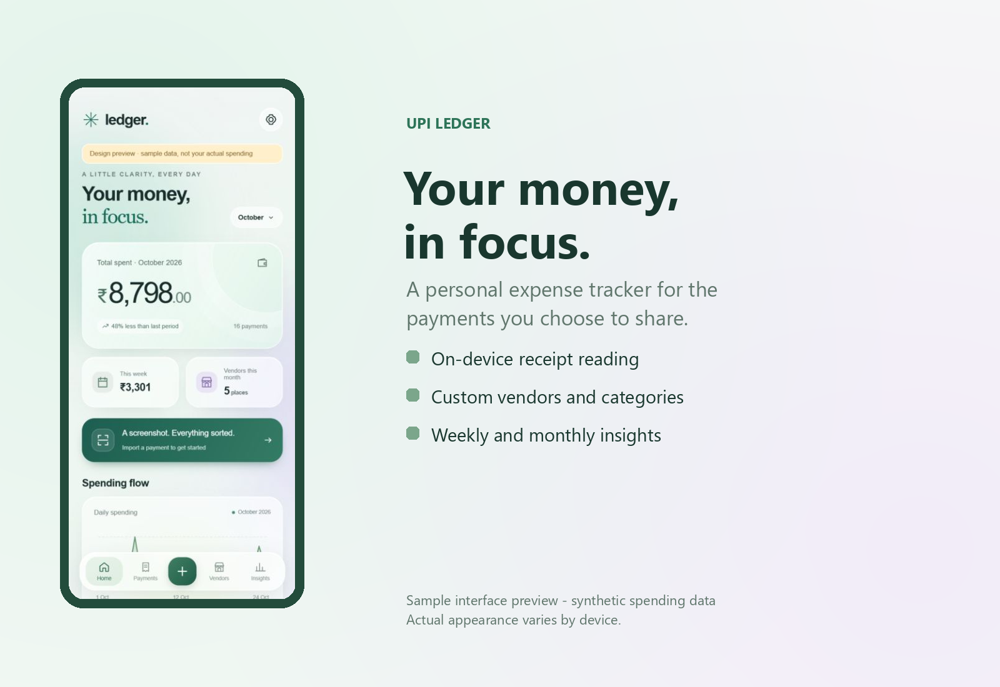
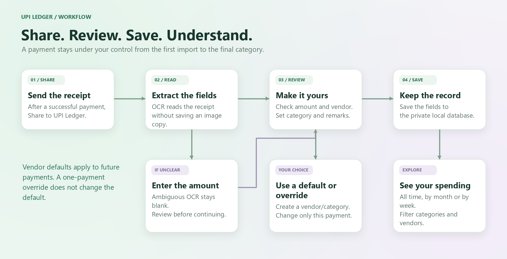

# UPI Ledger

Current version: **0.3.0** - Monthly budgets and spending reports.

A personal Android expense tracker that turns shared payment receipts into organized spending records.

Share a BHIM or Google Pay receipt image to **UPI Ledger**, review the extracted fields, choose a category, and save. The app uses on-device text recognition and stores structured records locally.



## Features

- Receive payment receipt images through Android's Share menu, or choose an image manually.
- Extract amount, vendor, payment date/time and transaction reference when readable.
- Review and edit every field before saving; add optional remarks.
- Create your own categories and vendors.
- Set vendor defaults and override the category for an individual payment.
- Remember unfamiliar payment names as vendor aliases.
- Search payments and view a vendor's all-time, monthly or weekly history.
- Explore spending totals, daily trends, category shares and period comparisons.
- Export and restore JSON backups, including custom categories and vendors.
- Use a translucent glass-style interface with reduced-motion support.
- Create monthly subscriptions manually; record due renewals automatically when Ledger opens.

## Monthly budgets and exports

Open **Insights > Monthly budgets > Manage** (or Settings > Monthly budgets). Choose a month, category and rupee limit. The card shows saved spending, remaining money or overspend. Limits belong to individual calendar months; set zero to remove a limit. Changing a transaction category updates the matching budget totals.

Use **Export spending report** in Insights or Settings. Select start/end dates and choose **CSV (opens in Excel)** or **PDF report**, then choose where Android saves the file. CSV includes each payment's date, time, vendor, category, debit amount, remarks, transaction ID and source. PDF includes totals, category summaries, budgets and paginated payment details. Partial-month budget comparisons use only the dates in the report. Automatic subscription entries are included.

JSON backups now include budgets. Existing version 1-3 backups still restore. CSV and PDF are reports; use the JSON backup when moving or restoring Ledger data.

## Monthly subscriptions

Open **Subscriptions > Create subscription** and enter a name such as Spotify, monthly price and next renewal date. No screenshot is needed. The vendor is the subscription name and the category is **Subscription**.

On opening or resuming the app, due renewals become debit records on Home and Payments, dated to the scheduled renewal. Missed months are caught up; repeated openings do not duplicate them. An **Auto** label identifies these bookkeeping entries. Days 29-31 use the last day of a shorter month and return to the original renewal day afterward.

**Cancel subscription** stops future entries in Ledger and retains history. It does not cancel the real service or its bank autopay. Ledger neither moves money nor verifies bank settlement. Changes to the plan's amount affect future entries; historical payments stay as saved.

## Architecture


Read the [architecture notes](docs/ARCHITECTURE.md) for the bridge, database and amount-extraction details.

## Payment workflow



The architecture, workflow and framed app-preview images are rendered with Python/Pillow. Their sources are included in [tools/render_readme_images.py](tools/render_readme_images.py). The preview uses sample spending data.

## Quick start

1. Install [Android Studio](https://developer.android.com/studio) and finish its setup wizard.
2. Download or clone this repository and **open the project root folder** in Android Studio.
3. Install Android API **37.0** and Build Tools **36.0.0** through SDK Manager if missing.
4. Let Gradle sync. Android Studio creates the local SDK configuration for your computer.
5. Choose an emulator or connected Android device, then click **Run**.

The app supports Android 8.0 / API 26 and newer. It does not need a server, API key or cloud account. The first build needs internet access to download build tools and dependencies.

### Build from a terminal

Use JDK 21, or Android Studio's compatible bundled JDK. Gradle 9.6.0 is included through the wrapper; Android Gradle Plugin 9.4.0 requires at least JDK 17. Configure your SDK with `ANDROID_HOME` or a private `local.properties` file. See [local.properties.example](local.properties.example).

Windows PowerShell:

```powershell
.\gradlew.bat testDebugUnitTest lintDebug assembleDebug assembleDebugAndroidTest
node tests/model.test.cjs
```

macOS / Linux:

```sh
chmod +x gradlew
./gradlew testDebugUnitTest lintDebug assembleDebug assembleDebugAndroidTest
node tests/model.test.cjs
```

The debug APK is generated at `app/build/outputs/apk/debug/app-debug.apk`. Node.js is needed only for the spending-analysis JavaScript checks, not to build the Android app.

## Using the app

1. Open a successful payment receipt in BHIM or GPay.
2. Tap **Share** and choose **UPI Ledger**, when the payment app shares an image.
3. Check the extracted amount, vendor, date and time.
4. Choose a category, add remarks if needed, and save.

For example, Swiggy Instamart can default to **Food**, while a specific notebook purchase is saved under **Study supplies**. That override does not change the vendor default or other payments. Create a category from any category selector, or through Settings. Create vendors independently from the Vendors screen.

Share formats vary by payment-app version and device. Text-only links are not currently supported. The manual image picker and manual payment entry remain available.

## Privacy and data

- OCR runs on-device using a bundled ML Kit model.
- The app stores saved fields in its private SQLite database. It does not retain receipt-image copies or raw OCR text.
- Images are opened only through a shared URI or Android's document picker.
- No Internet, notification, SMS, contacts, accessibility or broad photo-library permission is requested.
- No continuous background monitoring is used.
- Existing gallery images and files belonging to other apps are not deleted.
- Automatic Android cloud backup and device-transfer backup are disabled; use the in-app JSON export/restore feature.

Uninstalling deletes local records. Export a backup first. Backup files contain financial details and are not encrypted by the app. The app-private database uses Android's app sandbox; this project does not add separate database encryption.

## OCR limitations

This is a prototype, not a bank reconciliation service. Saving assumes a successful outgoing payment; the app does not verify settlement or reconcile refunds.

The rupee symbol (₹) can be recognized as `7`. The parser compares available receipt amounts and uses character-size evidence to help distinguish currency glyphs from digits. When readings conflict or remain ambiguous, the amount stays blank for manual entry. Genuine amounts such as ₹740 and ₹7,400 are covered by regression tests. Always review extracted values before saving; existing records are not corrected automatically by an update.

Reports reflect only the payments saved in the app. Spending prompts identify patterns rather than deciding which purchases were necessary.

## Tests and automation

- Parser unit tests cover payment fields, currency ambiguity and amount conflicts.
- JavaScript tests cover calendar ranges, elapsed-period comparisons and daily/category totals.
- Android integration checks cover custom categories, vendor defaults, aliases, duplicate references, backup round-trips/rollback, schema migration, generated OCR examples and local UI/save behavior.
- The [GitHub Actions workflow](.github/workflows/android.yml) builds the debug APK, runs unit/analysis checks and lint, compiles the device-test APK and retains build reports. It does not run an emulator or publish a release.

The repository includes **no personal receipt fixtures**. OCR smoke tests draw synthetic receipts in memory. See [testing instructions](docs/TESTING.md) to run device checks.

## Project structure

```text
app/src/main/java/in/upiledger/app/   Android bridge, database, receipt parsing
app/src/main/assets/ui/              Local glass UI, subscriptions and spending analysis
app/src/main/res/                    Theme, app icon and backup rules
app/src/test/                        Parser unit tests
app/src/androidTest/                 Generated-receipt and device checks
tests/                              JavaScript analysis tests
.github/workflows/                   Build automation
docs/                               Architecture, testing and GitHub setup
tools/                              Python renderer for README images
gradle/wrapper/                      Portable Gradle wrapper
```

Read [architecture](docs/ARCHITECTURE.md), [contribution notes](CONTRIBUTING.md), or [how to upload this project to GitHub](docs/GITHUB_SETUP.md).

### Regenerate README images

```sh
python -m pip install -r tools/requirements-images.txt
python tools/render_readme_images.py
```

The app-preview renderer uses the included sample-data screenshot at `docs/images/dashboard-source.jpg`. No personal receipt images are needed.

## Signing and updates

Debug builds use the local development signing key. A build made on another computer or a fresh CI runner can have a different signing key and may not install over an existing copy. Keep your existing signing key private and backed up if you need updates to preserve that installation. Signing keys, APKs, payment backups and local SDK paths are excluded from this repository.

## License and attribution

No project license has been selected yet. The owner can add one through GitHub's license selector. Dependencies, including ML Kit and Gradle, retain their own terms. This project is independent and is not affiliated with BHIM, Google Pay, NPCI or any bank.
