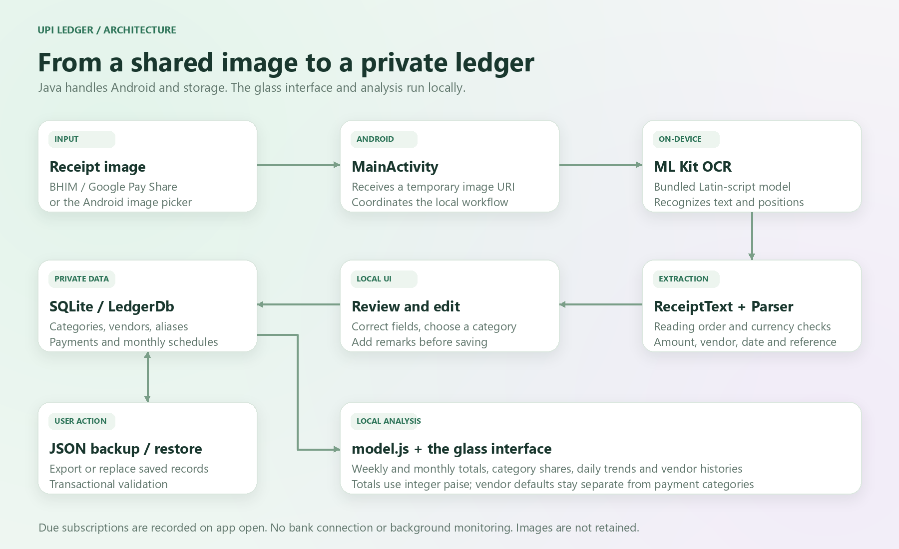

# Architecture

## Android host

`MainActivity` accepts `ACTION_SEND` with an image MIME type and document-picker results. Receipt images are read in memory; a shared URI is not copied into permanent app storage. OCR-derived fields are sent to the local editor for review. A successful save persists structured fields only.

The WebView serves five allowlisted assets from a local intercepted origin. Remote navigation, network loads, arbitrary file access and content access are blocked. Its JavaScript bridge validates input before changing the database. Dynamic strings are escaped before being inserted into the interface.

## Storage

`LedgerDb` schema version 3 contains categories, vendors, aliases, subscriptions and entries. A payment stores its category independently of its vendor's default. Changing the default affects future selections, not past classifications. Categories can exist without payments; vendors can exist before their first payment. Unique nonempty transaction references prevent duplicate saves.

Version 1 databases upgrade in place. Backup version 3 includes categories and subscriptions; restore also accepts version 1 and 2 backups. Restores run inside a transaction so malformed input can roll back without replacing existing records.

## Amount parsing

Explicit readable currency values take priority. Otherwise, the parser compares a header amount with debit/send lines. A leading 7 is not removed solely because it looks like a mistaken rupee glyph. Character-size evidence may normalize it; unresolved or conflicting readings leave the amount blank.

## Analysis

`model.js` uses local calendar dates and amounts represented as integer paise. Weeks run Monday to Sunday. Incomplete current periods compare against the same elapsed portion of the previous period. Vendor filters and global insights share these date helpers. The browser preview uses in-memory synthetic records and never represents actual user spending.

## Monthly renewal bookkeeping

Schema version 3 adds subscriptions and links each generated payment to its plan and scheduled due date. The unique plan/date index and a transaction around posting/advancing the date prevent duplicate renewals. Opening/resuming the app posts active due schedules using the stored monthly amount, service-name vendor and Subscription category. There is no scheduler service or bank integration. Cancellation deactivates the plan without deleting historical debits. Backups include schedules and links and still accept versions 1 and 2.
